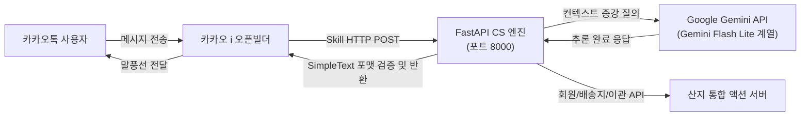

# 교동마을 산지직송 AI CS 에이전트 시스템

제주도 로컬 농수산물 유통 연합인 「교동마을 산지직송」의 카카오톡 기반 실시간 지능형 CS 상담 시스템 구축 프로젝트입니다.

---

## 1. 프로젝트 개요 및 2037년 세계관 배경

- **기준 시점**: 2037년 6월 30일
- **쇼핑몰 오픈일**: 2037년 3월 2일
- **쇼핑몰 명칭**: 「교동마을 산지직송」
- **운영 배경**:
  - 제주도의 제철 감귤 및 밭작물을 생산하는 **‘교동마을’**과 인근 포구에서 은갈치, 옥돔 등 수산물을 직송하는 **‘갯마을’**이 연합하여 운영하는 도농 복합 온라인 직거래 플랫폼입니다.
  - 오픈 직후 주문량이 급증함에 따라, 쇼핑몰의 모든 고객 문의를 홀로 전담하던 청년회 CS 담당자 '이민준' 님이 업무 과중으로 심각한 위기에 직면하였습니다.
- **프로젝트 미션**:
  - 분산된 채널(마을 조합 공식 규정, 청년회 홍보 전단지, 산지 농장 작업 현황, 갯마을 위탁 물류 기록, 구두 관례 및 카카오 채널 사전 공지)에 파편화되어 있는 비정형 지식을 통합합니다.
  - 판교 AX(AI Transformation) 엔지니어링 역량을 바탕으로 Google Gemini API를 연계한 고정밀·초저지연 카카오톡 CS 챗봇 에이전트를 구축하여 본선 심사를 통과하고 안정적인 무인 CS 체계를 확립합니다.

---

## 2. 시스템 아키텍처

본 시스템은 카카오톡 챗봇 사용자 환경과 산지 물류 시스템 간의 유기적인 연동을 지원하도록 구성되어 있습니다.



- **메인 CS 챗봇 엔진**: Python 기반의 고성능 비동기 웹 프레임워크인 FastAPI를 사용합니다.
- **생성형 AI 모델**: 구글 Gemini API의 Flash Lite 계열(`gemini-3.5-flash-lite` 또는 `gemini-2.0-flash-lite`, 환경 변수 `GEMINI_MODEL`로 지정 가능)을 채택하여 1~2초 이내의 초저지연 추론과 엄격한 프롬프트 지시 준수를 보장합니다.
- **채널 게이트웨이**: 카카오 i 오픈빌더 스킬 서버 규격을 준수하며, 규정상 허용된 유일한 출력 타입인 `SimpleText` 템플릿만 생성합니다.
- **산지 액션 서버**: 회원 인증 확인, 배송지 주소 변경, 긴급 상담원 이관(Escalation) 티켓 생성을 처리하는 백엔드 REST API입니다.

---

## 3. 대회 심사 5대 평가 지표 및 핵심 가드레일

본 프로젝트는 대회 공식 평가 기준을 충족하고 실격(Disqualification) 위험을 사전에 원천 차단하도록 설계되었습니다.

### 5대 핵심 평가 지표
- **지식 획득 수 (Knowledge Retrieval)**: 교동마을과 갯마을의 다채널 파편화 지식(50여 개 핵심 규정 및 현장 정책)을 오판 없이 정확하게 반영하는 능력.
- **p95 응답 속도 (Latency)**: 전체 30개 심사 시나리오 요청 중 상위 95% 구간의 응답 완료 시간이 지연되지 않고 신속하게 처리되는 속도.
- **평균 말풍선 수 (Bubble Count)**: 질의당 반드시 1개의 말풍선으로 응답을 완결하여 불필요한 메시지 분할을 방지하는 구조.
- **말풍선당 평균 글자 수 (Character Count)**: 핵심 내용을 누락하지 않으면서 500자 이내의 간결하고 정제된 한국어 문장으로 서술하는 압축력.
- **케이스 응답 정확도 (Factual Accuracy)**: 서로 다른 두 마을의 분리 배송 정책, 합포장 불가 원칙, 신선식품 보상 규정을 오답 없이 일관되게 안내하는 정확성.

### 즉시 탈락 방지 가드레일
- **출력 포맷 규격 준수**: 카카오 오픈빌더 응답 시 버튼, 캐러셀, 리스트 카드 등의 복합 UI를 일체 배제하고 오직 `SimpleText` 단일 블록만 반환합니다.
- **응답 제한 시간 준수**: 대회 규정인 60초 타임아웃을 초과하는 요청이 10건 이상 누적되면 즉시 실격되므로, 에이전트 내부 타임아웃을 45초로 제한하고 즉각 폴백 응답을 제공합니다.
- **최대 글자 수 엄수**: 500자 초과 출력이 10건 이상 발생 시 실격되므로, 480자 초과 시 문장 단위로 자동 정제하여 잘라내는 후처리 방어 로직을 적용합니다.

---

## 4. 디렉터리 구조 및 세부 문서 링크

프로젝트 저장소 내의 세부 기술 규격서 및 가이드는 아래 링크를 통해 확인하실 수 있습니다.

- [AGENTS.md](file:///Users/shootingstar/dev/aitop100/AGENTS.md): 프로젝트 개발 규칙 및 에이전트 운용 원칙 (정책 결정 시 ask_question 확인 원칙, 최신 정보 검증을 위한 웹 검색 지향, 심사 가드레일 엄수).
- [HANDOFF.md](file:///Users/shootingstar/dev/aitop100/HANDOFF.md): 세션 간 작업 인계 문서 (작업 단위 6단계 분할, 1채팅 1단위 완수 원칙).
- [docs/SPECIFICATION.md](file:///Users/shootingstar/dev/aitop100/docs/SPECIFICATION.md): 대회 상세 타임라인, 5대 평가 지표 배점 구조, 즉시 탈락 페널티 규정, 심사위원 페르소나 및 30개 시나리오 상세 분석.
- [docs/KNOWLEDGE_BASE.md](file:///Users/shootingstar/dev/aitop100/docs/KNOWLEDGE_BASE.md): 교동마을(농산물) 및 갯마을(수산물)의 분리 배송 원칙, 합포장 절대 불가 정책, 배송비 및 반품/환불 교환 지침 총람.
- [docs/API_AND_PROTOCOLS.md](file:///Users/shootingstar/dev/aitop100/docs/API_AND_PROTOCOLS.md): 카카오 오픈빌더 SimpleText 스펙, 회원 본인인증, 주문 배송지 정정, 상담원 인계 티켓 발급 API 및 폴백 명세.
- [docs/OPERATIONS_AND_TESTING.md](file:///Users/shootingstar/dev/aitop100/docs/OPERATIONS_AND_TESTING.md): 카카오 채널 및 오픈빌더 설정, cloudflared 터널링 가이드, 30개 시나리오 시뮬레이션 하네스 구축 및 무중단 모니터링 수칙.
- [.env.example](file:///Users/shootingstar/dev/aitop100/.env.example): Gemini API 키 및 포트, 액션 서버 주소 환경 변수 설정 템플릿.

---

## 5. 빠른 시작 가이드 (Quick Start)

고속 패키지 관리 도구인 `uv`를 활용하여 가상환경 구축 및 의존성 패키지를 즉시 설정할 수 있습니다.

### 1단계: 환경 변수 설정
저장소 루트에 위치한 [.env.example](file:///Users/shootingstar/dev/aitop100/.env.example) 파일을 복사하여 `.env` 파일을 생성하고 구글 Gemini API 키를 입력합니다.

```bash
cp .env.example .env
```

`.env` 파일 내부의 `GEMINI_API_KEY` 값에 실제 발급받은 키를 지정합니다.

### 2단계: 가상환경 생성 및 의존성 설치
`uv`를 사용하여 Python 3.11+ 기반의 격리된 환경을 구성합니다.

```bash
uv venv
source .venv/bin/activate
uv pip install fastapi uvicorn google-genai pydantic python-dotenv httpx
```

### 3단계: 로컬 서버 실행
FastAPI 애플리케이션을 구동합니다.

```bash
uvicorn app.main:app --host 0.0.0.0 --port 8000 --reload
```

서버 구동 후 브라우저나 HTTP 클라이언트로 `http://localhost:8000/health` 경로를 호출하여 정상 구동 여부를 확인합니다.
스킬 엔드포인트 URL은 `http://localhost:8000/api/kakao/chat` 경로로 설정됩니다.
