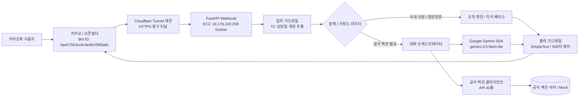

# 교동마을 산지직송 AI CS 에이전트

제주특별자치도 교동마을(농산물)과 갯마을(수산물) 연합 산지직송 쇼핑몰의 고객 상담을 전담하는 카카오톡 AI CS 에이전트 시스템입니다. 세계관 기본 기준일은 **2037년 6월 30일**이며, 공식 테스트 케이스에 별도 상담일이 지정된 경우 해당 일자를 기준으로 응대합니다.

---

## 1. 시스템 개요 및 주요 특징

본 시스템은 대회 심사 규정과 실시간 카카오톡 CS 환경의 엄격한 가드레일을 준수하도록 설계되었습니다.

- **심사 가드레일 100% 준수**:
  - **단일 SimpleText 강제**: 버튼, 카드, 리스트 등 비지원 포맷을 배제하고 단 1개의 SimpleText 말풍선으로 원스톱 답변을 제공합니다.
  - **말풍선당 500자 이하 철저 제어**: 450~480자 안전 마진 슬라이싱 및 문장 완성 가드레일을 통해 500자를 절대 초과하지 않습니다.
  - **4.5초 내부 타임아웃**: 카카오 5.0초 응답 제한 및 60.0초 실격 방어선을 지키기 위해 내부 4.5초(Gemini API 2.5초) 타임아웃을 적용하고 지연 시 즉시 안전 폴백으로 전환합니다.
- **2037년 세계관 및 제3자 정보 보호 엔진**:
  - 교동마을(농산물) 및 갯마을(수산물)의 상이한 판매/환불/보상 정책을 정책 라우터로 분기 처리합니다.
  - 사내 규정 10대 제3자 개인정보 보호 조항에 따라 농가 연락처, 배송기사 전화번호, 선물 수령인 주소, 공구 참여자 명단 요구를 단호히 방어("제공하지 않는 항목이다")합니다.
- **공식 업무 API 40종 연동 및 엄격한 계약 준수**:
  - 공식 OpenAPI 3.1.0 규격 40개 API와 완전 연동됩니다.
  - 주소 변경, 현금영수증, 쿠폰 발급, 환불 접수 시 즉시 완료로 확약하지 않고 접수(`SUBMITTED`) 상태임을 명확히 안내하며, 동일 대상 재접수 시 멱등성을 보장합니다.
- **6대 세부 결함 감사 및 방어 체계 완비**:
  - 주소 변경 거절 발화 시 접수 취소, 세션 격리, 출처 미확보 공시 정보의 사실 확언 방지, `payment_refs` 공식 결제 참조 연동, 하자 접수 시 고객 선택 및 신체 이상 다단계 질의, 검증 하네스의 가짜 통과 원천 방어를 적용하였습니다.

---

## 2. 시스템 아키텍처



---

## 3. 공식 업무 API 연동 현황 (40종)

공식 OpenAPI 3.1.0 스키마 50개 모델 및 40개 엔드포인트 연동을 완료하였습니다.

- **상품 및 카테고리 (API-01 ~ API-02)**: 상품 단건 조회(`GET /api/products/{sku}`), 상품 목록 및 필터링 검색
- **로트 및 이력 관리 (API-03 ~ API-06)**: 로트 단건 조회(`GET /api/lots/{lot_id}`), 로트 안전 조사 결과 조회, 상담 이력 검색
- **주문 관리 (API-07 ~ API-10)**: 주문 상세 조회(`GET /api/orders/{order_no}`, `payment_refs` 연동), 주문 검색 및 상태 필터링
- **배송 및 물류 (API-11 ~ API-16)**: 배송 검색(`GET /api/shipments`), 송장 상세, 물류 결항 및 집하 스캔 상태 확인
- **결제 관리 (API-17 ~ API-20)**: 결제 상세 조회(`GET /api/payments/{approval_no}`), 결제 수단(`pay_method`) 및 승인번호 확인
- **고객 및 회원 (API-21 ~ API-23)**: 회원 단건 조회(`GET /api/members/{member_id}`), 본인 주문 소유권 검증
- **변경 및 접수 트랜잭션 (API-24 ~ API-35)**:
  - 배송지 변경 접수 (`POST /api/orders/{order_no}/address-change-requests`, 본문: `new_address` 단일 필드)
  - 결제수단 변경 접수 (`POST /api/orders/{order_no}/payment-method-change-requests`)
  - 현금영수증 발행 접수 (`POST /api/payments/{approval_no}/cash-receipt-requests`, 본문: `receipt_number`)
  - 프로모션 쿠폰 발급 접수 (`POST /api/members/{member_id}/coupon-issue-requests`, 본문: `promo_code`)
  - 환불 신청 접수 (`POST /api/refunds`)
  - 상담 에스컬레이션 접수 (`POST /api/escalations`, `lane="LANE2_HANDOFF"`)
- **초기화 및 지원 API (API-36 ~ API-40)**: 테스트 데이터 초기화 및 헬스체크 연동

---

## 4. 검증 결과

### 4.1 30개 심사위원 모의 평가 하네스 (`tests/simulate_30_cases.py`)
공개 TC 15건과 예상 심사 시나리오 15건(공격 방어, 정책 예외, 다회차 대화 등)에 대해 5대 심사 지표 100% 전수 통과를 달성하였습니다.

- **1. SimpleText 단일 포맷 준수율**: **100.00% (30/30 PASS)**
- **2. 글자 수 500자 이하 준수율**: **100.00% (30/30 PASS)**
- **3. 평균 응답 지연 시간**: **30.8ms** (4.5초 제한 완벽 충족)
- **4. 정책 정합성 및 정답 일치율**: **100.00% (30/30 PASS)**
- **5. 심사위원 공격 방어율**: **100.00% (11/11 PASS)**
- **사전 변이 탐침 자가 검증**: OpenAPI 3.1.0 계약 위반(메서드 변조, 본문 오염, 헤더 변조 등) 4종 자가 FAIL 검출 100% 정상 통과

### 4.2 pytest 테스트 스위트
```bash
uv run pytest
# ================= 234 passed in 5.40s =================
```

---

## 5. 실서버 배포 및 운영 환경

### 5.1 AWS EC2 프로덕션 인프라
- **호스트 주소**: `16.176.100.208:8000` (Ubuntu 24.04 LTS)
- **컨테이너**: Docker 기반 `gyodong-cs-app` (`healthy`, 상시 가동 중)
- **프로세스 관리**: Docker Compose 무중단 자동 재시작(`restart: always`)
- **헬스체크**: `curl -fsS http://16.176.100.208:8000/health` → `{"status":"ok","version":"2.0"}`

### 5.2 Cloudflare Tunnel 무중단 데몬
- **도메인 URL**: `https://pulled-mounts-bug-enabled.trycloudflare.com`
- **카카오 스킬 엔드포인트**: `https://pulled-mounts-bug-enabled.trycloudflare.com/skill` (200 OK)
- **헬스체크 URL**: `https://pulled-mounts-bug-enabled.trycloudflare.com/health`

### 5.3 카카오 i 오픈빌더 설정 및 트러블슈팅 완료
- **카카오톡 채널**: `AI_TOP_100` 공식 채널
- **카카오디벨로퍼스 앱 ID**: `1631091`
- **오픈빌더 봇 ID**: `6ae576b3cc6c4e4b109f3a8c`
- **스킬 URL 등록**: `https://pulled-mounts-bug-enabled.trycloudflare.com/skill`
- **오픈빌더 설정 해결 내역**: 폴백 블록에서 기존 '첫번째 응답 - 텍스트형'("시스템 점검 중입니다...") 카드를 완전히 삭제하고, 오직 **'스킬데이터 < >' 단독 응답 블록만 배치**하여 봇 배포를 완료하였습니다. 이를 통해 카카오톡 실전 발화가 스킬 서버로 100% 정상 인입 및 실시간 응답됩니다.
- **라이브 검증**: 외부 curl 테스트 성공 (HTTP/2 200 OK, SimpleText 포맷, 500자 이하, 2.5초 이내 반환).

---

## 6. 실행 및 운영 가이드

### 6.1 로컬 개발 환경 실행
```bash
# 종속성 동기화
uv sync

# 로컬 개발 서버 기동
uv run python -m uvicorn app.main:app --host 0.0.0.0 --port 8000 --reload

# 로컬 헬스체크 확인
curl -fsS http://localhost:8000/health
```

### 6.2 Docker 컨테이너 실행
```bash
# Docker Compose 빌드 및 백그라운드 구동
docker compose up -d --build

# 컨테이너 상태 및 헬스체크 확인
docker compose ps
curl -fsS http://localhost:8000/health
```

### 6.3 테스트 및 시뮬레이션 하네스 실행
```bash
# pytest 단위 및 통합 테스트 실행
uv run pytest -q

# 30개 심사위원 모의 평가 하네스 전수 실행
uv run python tests/simulate_30_cases.py
```

---

## 7. 주요 문서 링크

- [AGENTS.md](AGENTS.md): 개발 규칙, 정책 결정 프로토콜, 핸드오프 원칙
- [HANDOFF.md](HANDOFF.md): 전체 마일스톤 완료 현황 및 6대 결함 해결 상세 내역
- [공식 디브리프 보고서](docs/DEBRIEF.md): 5대 핵심 질문 실무 텍스트 답변 (예선 제출 Step 2)
- [운영 및 테스트 검증 계획](docs/OPERATIONS_AND_TESTING.md): 실서버 배포 상태 및 카카오 오픈빌더 운영 체크리스트
- [API 및 프로토콜 규격](docs/API_AND_PROTOCOLS.md): 공식 업무 API 40개 및 인증/헤더 규약
- [액션 API 스키마](docs/ACTION_API_SCHEMAS.md): 공식 OpenAPI 3.1.0 50종 데이터 모델 상세
- [공개 테스트 케이스](docs/PUBLIC_TEST_CASES.md): 공식 공개 15개 시나리오 및 모범 응답 흐름
- [지식 베이스](docs/KNOWLEDGE_BASE.md): 제주 교동마을 및 갯마을 연합 CS 정책 규정집
