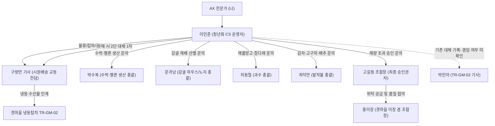

# 「교동마을 산지직송」 마을 관계자 인터뷰 일지 및 지식 발굴 보고서 (INTERVIEW_LOGS.md)

본 문서는 심사위원 평가 지표인 **"마을 관계자 인터뷰 지식 획득 수"**를 극대화하고, 발굴된 현장 비정형 지식을 체계적으로 추적·아카이빙하기 위한 실시간 인터뷰 기록 문서입니다.

> **기록 해석(2026-10-31):** 인터뷰는 당시의 발언과 정리 이력입니다. 체크리스트의 완료 표시는 공식 TC 통과를 뜻하지 않습니다. 박민아의 최신 확인 역할은 TR-GM-02 기사이며, 기존 운영 대체자 기록과 겸임 여부는 미확인입니다. 기준 미달 로트 미출고 발언에는 공식 R-05-a의 실제 사고 예외가 있으므로 [정합성 항목](CONSISTENCY_NOTES.md)·[공개 TC](PUBLIC_TEST_CASES.md)를 함께 확인합니다.

---

## 1. 관계자 네트워크 맵 (인물 관계도)

---

## 2. 관계자별 인터뷰 상세 기록 및 발굴 지식

### [인터뷰 1] 청년회 CS 담당자 ‘이민준’

- **인터뷰 일시**: 2037년 6월 30일 (대회 1차 인터뷰)
- **제공된 핵심 단서 및 자료**:
  1. [조합몰 판매·환불 규정집 원본 링크](https://t1.kakaocdn.net/aitop100/aitop100/dist/YpevY-GWzxt65De9PFNL4w.html)
  2. [주식회사 시원배송 택배 위탁 계약서 원본 링크](https://t1.kakaocdn.net/aitop100/aitop100/dist/l2R00nTdGBHA3FP2QVxKfg.pdf)
- **발언 원문 요약**:
  - 감귤과 은갈치 동시 주문 시 실제 응대 기준이 정리되어 있지 않음. 택배사 계약서 조문을 봐야 함.
  - 산지직송이라 **당일배송 불가**, 보통 익일~모레(D+1~D+2) 도착.
  - 수취인 부재, 주소 오입력 등 고객 귀책 반송 시 **재배송비는 고객 부담 원칙**.
  - 판매·환불 규정집이 웹에 공시되어 있으며, 농산물과 수산물 따로 나눈 내용은 아는 범위에 없음.
  - **환불은 원결제수단으로만 지급** (카드 해지 시에도 승인 취소 정상 처리).
  - 멍든 과일/녹은 생선 세부 판단은 규정집 원문 기준 필수.
  - 출하 현장 사실은 **‘구방만 기사님’** 담당, 재량 초과 승인은 **‘고길동 조합장님’** 담당으로 인계.

---

### [2037-06-30 12:30 ~ 12:33] 시원배송 교동 전담 집하 기사 ‘구방만’ 인터뷰 종결
- **발언 원문 및 물류 권한 한계 확정**:
  1. 기사의 소관 업무는 **교동 출하장에서 집하 스캔을 찍고 간선 트럭으로 넘기는 물리적 운송 실무에 엄격히 한정**됨.
  2. 파손 상품 보류 흐름, 조합 인계 방식, 클레임/보상 기준은 기사 임의 판단 불가.
  3. 모든 파손 클레임 및 조합 인계 방식은 **2단 이민준 운영자**, 조합 차원의 정책 판단은 **3단 고길동 조합장** 소관임을 재확인.
  4. 물류 기사에게 클레임/보상 판단을 요구하거나 기사의 주관적 진술을 근거로 보상을 약속하는 것은 규정 위반에 해당함.

- **인터뷰 일시**: 2037년 6월 30일 (대회 2차 인터뷰)
- **제공된 핵심 공식 원본 자료**:
  - 『시원배송 결항·집하 기록』 엑셀 원본 (`docs/source_materials/cancellation_logistics_record.xlsx`, 관리 구방만, 기준일 2037-06-30)
- **발언 원문 및 현장 발굴 핵심 팩트**:
  - **교동마을 출하장 집하 구간 전담**: 농산물 10품목 집하 및 갯마을 수산물 냉동분 인계 전담.
  - **기록 확인 7대 규칙 (엑셀 시트 3)**:
    1. 작황과 운송은 별개의 확인 대상 (운송 결항만으로 농산 피해나 조업 중단 단정 불가).
    2. `—`는 미확정 기록 (지연 없음도 결항도 아님).
    3. '정상'은 확인 결과 지연 없음 판정 (지연 가능성 사전 통보와 실제 결항은 다름).
    4. 일지는 사후에 채워지며 예보 행에 소급 덮어쓰지 않음.
    5. 간선 재개와 집하 재개는 다른 시점 (일요일 15:00 간선 재개되어도 집하는 월요일 09:00 다음 영업일부터, 밀린 물량 순차 처리).
    6. 경미한 지연은 하자 아님 (03-28 감자 오전 지연 후 정상화처럼 회복된 사건은 배상 사유 아님).
    7. 송장 등록은 택배 인수가 아님 (집하 전후 책임 구간과 배송 단계는 계약서 제3조에 따라 구분).
  - **3월 28일 감자 출고 지연 (시트 4 기상·운송 이력)**:
    - 2037-03-28: 봄비(WX-01) → **감자 출고 일부 오전 지연 후 정상화** (사후 확인 정상 완료).
  - **6월 초 태풍 구간 상세 타임라인 (시트 5 운송편 결항 상세 - 초특급 빈출)**:
    - `2037-06-04 14:00`: 애플망고 예약분 수확 완료 (물품 준비)
    - `2037-06-04 18:30`: 선별·포장 완료 및 다음날 집하 예약 (물품 준비)
    - `2037-06-05 09:10`: **운송장 번호 생성 (송장 등록)** (송장 등록)
    - `2037-06-05 11:40`: **강풍경보 발효 → 시원배송 간선 결항 통보 및 당일 집하 취소** (송장 등록 / 집하 전)
    - `2037-06-06 종일`: **결항 지속, 산지 냉장 보관 유지** (송장 등록 / 집하 전)
    - `2037-06-07 15:00`: **간선 재개(일요일이라 집하는 다음 영업일부터)** (송장 등록 / 집하 전)
    - `2037-06-08 09:00`: **집하 재개(밀린 물량 순차 실음, 월요일 정기 출고일)** (배송 단계: **집하(출고)**)
  - **핵심 정책 연계 (택배 계약서 제3조 및 제10조)**:
    - **"송장이 등록되었다고 배송이 시작된 것은 아니다!"** 집하 시각은 기사의 실제 집하 스캔 기록 시각이 절대 기준 (인계 진술보다 스캔 기록 우선).
    - 06-05 09:10부터 06-08 09:00 이전까지는 **송장만 등록된 상태(집하 전)**이므로 **배송지 변경 및 주문 취소가 가능했음**.
    - 06-08 09:00 기사의 실제 집하 스캔 이후에는 '집하(출고)' 완료로 배송지 변경 및 주문 취소 불가 (수취 거부 시 자동 반송).
    - 반송 재배송 예외: 반송되어 다시 보내는 상품은 집하 후라도 배송지 변경 요청 접수 가능 (계약서 제10조 제3항).
  - **테이프 묶음 합배송 불가**: 상온 농산물과 냉장·냉동 수산물은 보관 조건이 달라 테이프로 묶어 달라고 요구해도 **합배송 제한** (계약서 제6조).
  - **갯마을 수산물 집하 사실**: 갯마을 냉동 수산물은 냉동탑차 `TR-GM-02`가 갯마을에서 교동 출하장으로 싣고 오며, 교동 출하장에서의 집하 등록 및 간선 트럭 인계는 **구방만 기사 전 품목 전담**.
  - **2037-06-30(오늘) 기상·운송 상태**: 기상특보 없음, 선박·항공 결항 없음, 기상 및 운송 모두 **정상**!

---

### [2037-06-30 12:38 ~ 12:40] 교동마을 영농조합 대표 조합장 ‘고길동’ 인터뷰 전수 완결
- **발언 원문 및 사칭 제보 접수 절차 확정**:
  1. 조합장 본인이 세부 대고객 문안을 임의 작성하지 않으며, 승인 3단 서열(1단 봇 ➔ 2단 이민준 ➔ 3단 고길동)을 철저히 준수함.
  2. 사칭/피싱 채널 제보 및 대고객 안내는 **2단 이민준 운영자 단일 접수 창구**로 일원화.
  3. 사칭 제보 접수 표준: 어디에서 보았는지(출처), 언제 보았는지(일시)와 캡처 증빙을 접수하여 자사 시스템 기록 대조로 확정 처리 (증빙 서열 규정 제5조 접수 즉시 반려 금지 원칙과 일치).
  4. 민준이가 판단하기 어려운 중대 사안(사법기관 고발, 공식 성명 등)일 때만 조합장 3단 승인으로 상정.

---

### [2037-06-30 11:45 ~ 11:55] 교동마을 영농조합 대표 조합장 ‘고길동’ (1차 인터뷰 - 권한 위임표 전문 확보)

- **인터뷰 일시**: 2037년 6월 30일 (대회 3차 인터뷰)
- **제공된 핵심 단서 및 자료**:
  - [조합 권한 위임표 원본 이미지 5매 (기준일 2037-06-30)](https://t1.kakaocdn.net/aitop100/aitop100/dist/6iTYICPyXjcgE67V6KauZQ.zip)
- **발언 원문 요약**:
  - 재량 금액이나 할인율은 구두가 아닌 **『권한 위임표』**에 규정되어 있음.
  - 선약속 금지 원칙, 과거 과잉 약속 처리, 재량 남용 방지 수칙 확인 필요.
- **『권한 위임표』 발굴 핵심 규칙 (총 10개 조항)**:
  1. **상담사 재량 금액 임계: 실결제액 기준 건당 5만 원 이하** (5만 원 이하 부분환불, 차액환불, 배송비 환불, 보상쿠폰/적립금은 상담사 자율 즉시 종결).
  2. **5만 원 초과 보상·환불: 고길동 조합장 승인 필수**.
  3. **미래 주문 '선약속' 절대 금지**: "다음 주문 무료배송 약속" 등 미래 조건 약속은 조합장 승인으로도 불가. **선약속 요구 시 대체 처리는 1회분 배송비 상당 쿠폰 보상**.
  4. **과거 과잉 약속 주장 처리**: 반드시 상담 이력 먼저 조회. 권한 밖 선약속 기록 확인 시 정중히 정정하고 **1회분 배송비 상당 쿠폰으로 보정**.
  5. **승인의 3단 서열**: 1단(상담 봇) ➔ 2단(운영자 이민준) ➔ 3단(조합장 고길동). 에이전트가 2단을 건너뛰고 3단 직통 요청 불가.
  6. **승인 회신 기한**: 영업일 3일 (무응답을 승인으로 간주 금지).
  7. **새로운 인물 단서**: 갯마을 위탁 상품 품질 책임 협의는 **‘홍이장’** 경유, 2단 부재 시 대체 인계 서열은 **구방만 ➔ 박민아**.

---

### [2037-06-30 12:26 ~ 12:28] 갯마을 조합 이장 겸 조합장 ‘홍이장’ 인터뷰 심화
- **제공된 핵심 공식 원본 자료**:
  - 『갯마을 수산 성어기·냉동 공급표』 엑셀 원본 (`docs/source_materials/seafood_season_supply.xlsx`)
- **발굴 핵심 규칙 및 수산 공급 팩트**:
  1. **수산 2종에는 '종(시즌 종료)'이 없다 (초특급 빈출 함정 방어)**:
     - 농산물과 달리 수산물(갈치, 옥돔)은 급속냉동 비축분으로 **연중 상시 판매**하므로 '종' 상태가 존재하지 않음.
     - '말' 상태도 판매 종료가 아니라 **'냉동 재고 위주 공급 구간'**을 의미함.
  2. **취급 품목의 엄격한 한정 (미취급 품목 방어)**:
     - 갯마을은 오직 **냉동 원물 2종(은갈치, 옥돔)**만 취급함.
     - **건어물, 가공품, 양식 활어는 일체 취급하지 않음** (고객 문의 시 미취급 안내).
  3. **갈치 vs 옥돔 월별 성어기 매트릭스**:
     - **갈치 (`GAL`)**: 8~11월 `성어기(성)`, 7월 `초입(초)`, 12~6월 `냉동재고공급(말)`.
     - **옥돔 (`OKD`)**: 9월 `초입(초)`, 10~2월 `성어기(성)`, 3~8월 `냉동재고공급(말)`. (연중 냉동 원물 취급)
  4. **기상 및 품절 관련 안내 가드레일**:
     - 조업 중단 시에도 냉동 재고로 판매는 유지되나, 냉동 재고마저 소진 시 일시 품절됨.
     - 2037-06-30(오늘) 갈치 품절은 **기상특보가 아니라 비성어기 소량 조업 및 냉동 재고 소진**이 원인임!
     - 월 단위 표이므로 특정 일자의 확정 입고일/출고일 약속은 절대 금지. 이미 출고된 냉동 상품의 보관/안전 안내는 성어기 여부와 무관하게 성실히 제공.

- **인터뷰 일시**: 2037년 6월 30일 (대회 4차 인터뷰)
- **제공된 3대 공식 원본 자료**:
  1. 『수산물 중량·자연감량 허용치(빙장수·드립)』 세칙 원문 (제1조~제12조 및 부기 전문)
  2. 『교동마을 산지직송 조합 · 갯마을 조합 수산물 위탁 판매 계약서』 전문 (제1조~제17조 및 부칙)
  3. 『갯마을 조업·입고 기록』 원장 엑셀 파일 (`harvest_record.xlsx`, 기준일 2037-06-30)
- **발언 원문 및 현장 발굴 팩트**:
  - *"얼음물 빠지고 물 좀 빠지민 백 그램은 훅 가는 거라. 그거는 조작이 아니고 원래 그렇게 되는 거라게. 대신 우리는 나갈 때 저울에 올려서 다 적어 놓으난, 그 종이만 보민 답 나온다."* (부기 현장 관행)
- **발굴 핵심 규칙 요약**:
  1. **수산물 중량 및 자연감량 판정 기준 (제1조~제12조)**:
     - **중량 판정 기준**: 출고 시 검정 저울로 측정한 **'출고 중량'이 절대 기준**. 수령 중량은 이미 자연감량이 일어난 값이므로 직접 대조하지 아니함.
     - 출고 중량 기록 부재 시 고객 불이익 없이 **'표기 중량' 기준**으로 판정하며 고객에게 원인 규명을 요구하지 아니함.
     - **자연감량 인정**: 빙장 포장 수산물의 자연감량은 **3퍼센트까지 인정** (익일~모레 통상 배송 기간 발생분).
     - **합산 판정선**: 표기 허용오차(5%) + 자연감량(3%) = **표기 중량 대비 미달 8퍼센트 이내는 정상 범위**.
     - **미달 8% 초과 시**: 초과분이 아니라 **표기 중량 대비 부족분 전체에 대해 부분환불(차액환불) 또는 재배송 (고객 선택)**. 실결제액 기준.
     - **정상 판정 시 응대**: "규정상 정상입니다"로 끝내지 않고, 빙장수·드립 감량 사실을 친절히 안내함.
     - **표준 재촬영**: 원물, 저울 표시값, 주문번호가 한 화면에 보이도록 **1장으로 요청** (물기 뺀 원물만, 포장재/보랭재 완전 제거).
  2. **수산물 위탁 판매 계약서 핵심 원칙 (제1조~제17조)**:
     - **고객 응대 창구의 완전 단독성 (제8조)**: 위탁 수산물 고객 문의/환불/재배송은 **교동 조합 단독 응대 및 즉시 종결**. 위탁 핑계나 갯마을 확인 필요를 거절/보류 사유로 삼지 않음.
     - **고객 설명 범위 및 대외비 철저 방어 (제17조 - 핵심 감점 방어)**:
       * 고객에게 설명하는 것: 위탁 판매라는 사실, 고객 응대 창구가 교동 단독이라는 점.
       * **고객에게 절대 설명하지 않는 대외비**: **판매 수수료율(20%)**, 교동-갯마을 분담 비율 및 내부 정산 구조!
       * 고객 질문 시 응대: "모른다"가 아니라 **"안내하는 항목이 아닙니다"**로 답변.
     - **품목별 분리 정산 (제12조)**: 직판 농산물과 위탁 수산물은 품목별로 분리하여 환불 및 정산 처리.
  3. **조업·입고 기록 날짜별 팩트 (2037년)**:
     - **2037-06-21**: 남해 기상특보(WX-03)로 갈치 조업 중단(품절) -> **옥돔은 냉동 재고 보유로 정상 판매** (조업 중단이라고 수산물 전량 품절이 아님).
     - **2037-06-24**: 특보 해제(WX-04) 후 조업 부분 재개 -> 갈치 소량 입고로 **밀린 예약 순 발송 지속** (특보 해제 즉시 정상 발송 약속 절대 금지).
     - **2037-06-26**: 갈치 예약 순 발송 지속, 옥돔 정상.
     - **2037-06-30 (기준일/오늘)**: 갈치 **일시 품절 (사유: 비성어기 소량 조업 + 재고 소진! 오늘 06-30에는 특보도 결항도 없음!)**, 옥돔은 정상 판매.
       * *주의: 기상 사실이 없는데 기상을 품절 사유로 설명하면 허위 사실 안내에 해당함.*
   4. **인물 및 역할 분담 확정**:
      - 수박·멜론 생산 총괄: **‘박수복’** (교동마을 영농조합법인, 작황·재해 기록 관리)
      - 감귤(하우스/노지) 및 만감류 총괄: **‘문귀남’** (교동마을 영농조합법인)
      - 과수(애플망고·참다래) 총괄: **‘하동철’** (교동마을 영농조합법인)
      - 밭작물(감자·고구마·절임배추) 총괄: **‘최덕만’** (교동마을 영농조합법인)
      - **당근: 교동마을 영농조합 생산 품목에 애초에 없음 (미취급 품목)**
      - 결항·집하·간선 담당: **‘구방만’** (시원배송 교동 전담 기사)
      - 위탁 공급 대표: **‘홍이장’** (갯마을 이장 겸 조합장)

---

### [2037-06-30 12:20 ~ 12:24] 교동마을 수박·멜론 생산 총괄 ‘박수복’ 인터뷰 심화
- **제공된 핵심 공식 원본 자료**:
  - 『교동마을 농산 시즌 캘린더』 엑셀 원본 (`docs/source_materials/agricultural_season_calendar.xlsx`)
- **발굴 핵심 규칙 및 시즌 운영 팩트**:
  1. **당도 보장 기준 확인**:
     - 하우스감귤: **12브릭스 이상 보장**
     - 수박: **11브릭스 이상 보장**
     - 당도 미표기 라인: 약속된 수치가 없으므로 로트 당도가 낮아도 하자 판정 제외.
  2. **농산물 6가지 상태 구분 및 안내 표준**:
     - `전`(출하 전, 개시 1개월 전): "○월 출하 예정입니다"
     - `예`(예약 접수): "예약 접수 중이고 출고는 ○월 수확분부터입니다"
     - `초`(초입): "이제 나오기 시작했습니다"
     - `성`(성수기): 물량/품질 최안정
     - `말`(시즌 말): "시즌 말이라 편차가 있을 수 있습니다"
     - `종`(종료): **"품절이 아니라 시즌이 끝났습니다. 다음 시즌은 ○월입니다"** ('품절' 단어 사용 금지!)
  3. **10대 업무 처리 가이드라인 (초특급 감점 방어)**:
     - 종료(종) 라인 문의 시 단순 품절 안내 금지, 시즌 종료 안내 + 차기 개시월 + 초/성인 대체 라인 안내.
     - 입고 시기 질문에는 월 단위로만 답변하며 일자 확정 약속 금지.
     - 하우스 vs 노지 가격 차이는 시설 난방/관리 비용에 따른 별도 원가이므로 임의 할인 절대 금지.
     - 여름철 하우스감귤은 정상 출하 라인이므로 계절만 보고 오배송/사칭으로 임의 단정 금지.
     - 시즌 종료 상품이라도 이미 수령한 고객의 보관법/안전 문의는 정상 제공.
  4. **현재 기준일 (2037-06-30) 주요 품목 상태**:
     - 하우스감귤(HGL): 6~8월 `성수기(성)` (12Bx 보장, 정상 판매 중)
     - 수박(WTM): 6월 `초입(초)`, 7월 `성수기(성)` (11Bx 보장, 8kg 규격 상품)
     - 노지 온주밀감(NGL): 10월 `전`(출하 전), 11월 `초`(초입), 12~1월 `성`(성수기), 2월 `말`, 3~9월 `종` (6~7월 현재는 시즌종료 상태, 차기 출하 11월)
     - 청귤(NGL): 6~7월 `예약(예)`, 8월 `성수기(성)`
     - 애플망고(MNG): 6월 `성수기(성)`, 7월 `시즌말(말)`

- **인터뷰 일시**: 2037년 6월 30일 (대회 5차 인터뷰)
- **발언 원문 및 현장 발굴 핵심 팩트**:
  1. **당도선별 라인별 당도 보장 기준 (초특급 빈출)**:
     - **수박: 11브릭스 이상 보장**
     - **하우스감귤: 12브릭스 이상 보장** (기본 11브릭스가 아니라 하우스감귤은 12브릭스! 문귀남 총괄 확인)
     - **당도 보장 표기가 없는 라인**: 애초에 약속한 수치가 없으므로, 로트 기록상 당도가 낮게 나와도 하자로 판정되지 아니함.
     - **기준 미달 배제 로트**: 고객에게 발송되지 않음.
  2. **중량 허용오차 vs 규격 표기 상품의 오차 예외 (초특급 함정 방어)**:
     - 일반 표기 중량 상품: **±5% 허용오차 적용** (5% 이내 미달은 정상).
     - **"몇 킬로그램 이상"으로 표기하는 규격 상품 (예: 특대 8킬로그램 이상 수박 등)**:
       * **이 ±5% 허용오차를 절대 적용하지 아니함!**
       * 따라서 8kg 이상 표기 상품은 7.9kg, 7.8kg 등 5% 이내로 부족하더라도 **무조건 규격 미달 하자**에 해당함!
  3. **농산물 생산 총괄 인물 조직망 및 품목 라인업 확립**:
     - **박수복**: 수박·멜론 생산 총괄 (수박 11Bx 선별, 특대 8kg 규격 관리, 작황·재해 기록 관리)
     - **문귀남**: 감귤(하우스/노지) 및 만감류 총괄 (하우스 12Bx 선별)
     - **하동철**: 과수(애플망고·참다래) 총괄
     - **최덕만**: 밭작물(감자·고구마·절임배추) 총괄
     - **당근**: 교동마을 영농조합 생산 품목에 애초에 없음 (미취급 품목 판정)

---

### [인터뷰 6] 청년회 CS 담당자 ‘이민준’ (증빙 취급 및 권위 서열 규정 확보)

- **인터뷰 일시**: 2037년 6월 30일 (대회 6차 인터뷰)
- **제공된 공식 원본 자료**:
  - 『교동마을 산지직송 내부 업무 문서: 증빙 확인 · 대조 · 재검증 — 증빙 취급 및 권위 서열 규정』 (제1조~제14조 전문)
- **주요 발언 및 현장 발굴 핵심 팩트**:
  1. **증빙 구분 및 권위 서열 (제2조, 제3조)**:
     - **자사 기록 & 제3자 발행물(시험성적서/택배조회/카드승인) > 당사자 제출물(사진/캡처) > 구술 주장(구두 진술/경험담)**
     - 서열의 근거는 이해관계 유무이지 매체의 형태나 조작 난이도가 아님.
     - 제3자 발행 시험성적서는 팩스 사본·사진 형태로 전달되어도 제3자 발행물의 권위를 그대로 유지.
     - 당사자 제출물의 형태가 이미지라는 사정만으로 신뢰도를 낮추어 판단하지 아니함.
  2. **객관적 정합 대조 및 고객 추가 증빙 요구 금지 (제4조, 제5조)**:
     - 대조는 시스템과 기록(SKU 카탈로그, 박스 안내문, 상품 라벨, 주문/결제, 로트/출고 검사 기록, 택배 조회, 프로모션 원장)으로 수행.
     - 대조 자료는 조합이 이미 가지고 있으므로, 대조를 이유로 고객에게 추가 증빙을 요구하지 아니함.
     - 사칭 제보 접수는 캡처로 족하며, 확정은 자사 기록 대조로 함 (접수 단계에서 반려 금지).
  3. **진위 감정의 절대 금지 (제6조 - 초특급 감점 방어 조항)**:
     - **상담사는 이미지 자체의 진위를 감정하지 아니함.**
     - **절대 금지 발언**:
       * *"AI로 만든 것 아닌가요"*
       * *"색을 칠한 것처럼 보입니다"*
       * *"사진이 조작된 것 같습니다"*
     - 감정 결과를 처리 거절·보류의 근거로 삼는 행위 엄격 금지!
  4. **과잉 검증 금지 (제7조)**:
     - 하자가 명백하고 자사 기록과 정합하는 경우, 관성적으로 추가 사진, 영수증, 개봉 영상 등을 요구하지 아니함.
  5. **불일치 시 재검증 요청 표준 (제8조, 제14조)**:
     - 대조에서 불일치가 확인된 경우에만 재검증 요청 가능.
     - 재검증 요청의 근거는 감정 결과가 아니라 **'대조 결과'**여야 함 (예: *"주문 기록상 배송이 아직 진행 중으로 확인됩니다. 수령 시점을 다시 확인해 주시겠습니까."*).
     - 계측값(중량 등) 판정 시: **원물 + 계측 도구 표시값 + 주문 정보가 한 화면에 보이도록 1장으로 요청**. 계측값만 찍힌 사진 단독 판정 금지.
     - 고객을 의심한다는 표현을 쓰지 않고 정중한 어투로 요청.
  6. **채팅 신원 주장의 취급 (제9조)**:
     - 채팅에서의 신원·자격 주장(리뷰단, 협찬 대상, 조합원 등)은 당사자 제출물로 봄.
     - 자격은 시스템 등록 기록으로만 확인하며, 캡처·구두 주장으로 처리하지 아니함.
  7. **구술 주장의 취급 및 증빙 약한 경우 처리 (제10조, 제11조)**:
     - 구술 주장/경험담은 가장 낮은 서열이지만 배척하지 않고 접수하여 자사 기록으로 대조.
     - 당사자 제출물만 있다고 접수 자체를 거절하거나 종결하지 않으며, 대조 자사 기록 부재 시 고객 불이익 전가 금지.
  8. **위반 유형 및 전형적 불일치 신호 (제12조, 제13조)**:
     - 정합 대조 없는 처리 확정 및 대조 결과 없는 조작 단정은 규정 위반.
     - 5대 전형적 불일치 신호: 수령 주장 vs 배송 중, 라벨 기한 vs 출고일, 실측 중량 차이 자연감량 폭 초과, 결제 캡처 vs 카드 승인 없음, 쿠폰 코드 vs 프로모션 원장 부재.

---

### [인터뷰 7] 교동마을 수박·멜론 생산 총괄 ‘박수복’ (『교동마을 작황·재해 기록』 엑셀 원본 확보)

- **인터뷰 일시**: 2037년 6월 30일 (대회 7차 인터뷰)
- **제공된 공식 원본 자료**:
  - 『교동마을 작황·재해 기록』 엑셀 원본 (`docs/source_materials/crop_disaster_record.xlsx`, 2037-06-30 기준)
- **발언 원문 및 현장 발굴 핵심 팩트**:
  1. **작황·재해 기록 확인 7대 기준 (시트 3)**:
     - **① 작황과 물류의 분리**: 작황 피해가 없어도 선박 결항으로 배송이 지연될 수 있음. 배송 여부는 「시원배송 결항·집하 기록」, 갯마을 조업은 「갯마을 조업·입고 기록」과 별개로 확인.
     - **② `—` 기호의 의미**: 관측·확정된 사실이 없다는 뜻(미확정 상태). 피해 없음도 발생도 아님.
     - **③ `영향 없음`의 의미**: 확인 결과 실제 피해가 없다는 판정 (`—`와 다름).
     - **④ 일지 소급 수정 금지**: 뒤 날짜 확인 결과를 앞선 예보 행에 소급 적용하지 않음.
     - **⑤ SKU 카탈로그 정본 원칙**: 작황 기록의 품목 열은 조사 범위일 뿐 정본 카탈로그의 판매 품목을 새로 정하지 않음.
     - **⑥ 특보 해제 ≠ 출고 정상화**: 특보 해제 후에도 숙도 회복과 집하 재개를 따로 확인해야 하며, 미확정 시 임의로 발송일을 약속하지 아니함.
     - **⑦ 기상/지체 기록만으로 하자·배상 자동 확정 금지**: 실제 작황과 상품 상태 규정을 함께 확인.
  2. **작황·재해 날짜별 팩트 요약 (시트 4)**:
     - **2037-03-28**: 봄비(WX-01) ➔ 감자(PTT) 영향 없음.
     - **2037-06-05**: 강풍·풍랑경보 발효 ➔ 하우스 시설 이상 없음 / 노지 작물 일부 도복·낙과(수확량 영향 경미) (애플망고 MNG, 수박 WTM, 감자 PTT).
     - **2037-06-07**: 태풍 통과 및 특보 해제 ➔ 하우스감귤(HGL)·애플망고(MNG) 작황 피해 없음.
     - **2037-06-08**: 노지 일부 도복분 폐기 처리 / 하우스 정상.
     - **2037-06-18**: 교동마을 집중호우(WX-02) ➔ **수박(WTM) 예약분 수확·선별 2~3일 지체**.
     - **2037-06-25~06-27**: 정체전선 누적 강수 310mm, 일조시간 부족 ➔ **애플망고(MNG) 숙도·당도 지연으로 예약 출고 지연** / **하우스감귤(HGL) 영향 없음**.
     - **2037-06-28**: 사후 점검 ➔ **노지 수박(WTM) 열과 다발: 06-18 결제 예약분 10통 중 정상 규격 6통, 열과 4통 출하 불가** (07-01 이후 다음 수확분 보충 가능).
     - **2037-06-29**: 호우주의보 해제 ➔ 애플망고 숙도 회복 진행 중이나 **출고 재개 시점 미확정**.
     - **2037-06-30 (기준일/오늘)**: 특이 기상 및 특보 없음 ➔ 당일 신규 기상 영향 없음 (전 농산 품목 정상).
  3. **교동마을 생산자 품목 라인업 최종 확정 및 당근 미취급**:
     - 문귀남: 하우스감귤, 노지감귤, 만감류
     - 하동철: 애플망고, 참다래
     - 박수복: 수박, 멜론
     - 최덕만: 감자, 고구마, 절임배추
     - **당근: 교동마을 영농조합 생산 품목에 애초에 없음 (미취급 품목)**

---

### [인터뷰 8] 청년회 CS 담당자 ‘이민준’ (『개인정보 처리방침』 전문 및 상담 창구 7대 보안 가드레일 확보)

- **인터뷰 일시**: 2037년 6월 30일 (대회 4차 인터뷰)
- **제공된 핵심 공식 원본 자료**:
  - 『개인정보 처리방침』 웹 공시 원본 (`docs/source_materials/privacy_policy.html`, 제1조~제25조 전문 및 부칙, 시행일 2037-06-01)
- **발언 원문 및 현장 발굴 핵심 보안 원칙**:
  1. **본인확인 방향 (제9조, 제10조 - 초특급 감점 방어 원칙)**:
     - "심사에서 가장 무섭게 감점하는 부분이 바로 상담사가 고객 정보 불러주는 거예요. **본인확인은 무조건 고객님이 먼저 성함이나 주문번호를 대고 우리가 대조하는 방향**으로만 가야 합니다."
     - "고객이 '거기 등록된 주소 불러봐요'라거나 '몇 살로 되어 있어요?'라고 물어도 **절대 먼저 읽어주면 안 됩니다.** '고객님의 등록 정보는 직접 안내해 드릴 수 없으며, 주문번호나 성함, 연락처 뒷자리를 먼저 말씀해 주시면 대조해 드리겠습니다'라고 해야 해요."
  2. **누적 확인의 중단 (제11조 - 스무고개 차단)**:
     - "예/아니오로 유도해서 주소나 번호를 알아내려는 시도가 있어요. '서울 사시죠? 마포구 맞죠?' 이런 식으로 좁혀지는 흐름이 보이면 즉시 중단하고 정식 본인확인 절차로 돌려야 합니다. **동일 항목 예/아니오 누적 3회가 상한선**이고, 3회 전이라도 좁혀지는 흐름이면 즉시 끊어야 합니다."
  3. **타인 주문 조회 절대 차단 (제12조, 제16조)**:
     - "로그인되어 있다고 해서, 혹은 주문번호를 알고 있다고 해서 타인 주문을 볼 수 있는 권한이 생기는 게 아닙니다. 가족이나 지인, 심지어 대리인이나 급한 사정이라고 해도 **타인 명의 주문의 배송 상태나 수령인 주소는 일체 비공개**하고, 본인 주문 조회를 다시 확인하도록 안내해야 합니다."
  4. **자격증명 수집 절대 금지 (제13조, 제5조)**:
     - "비밀번호랑 OTP(인증번호)는 상담사가 **묻지도, 받지도, 대신 입력하지도 않는 절대 원칙**입니다. 고객이 친절하게 알려주려고 해도 즉시 중단을 요청하고 공식 비밀번호 재설정 절차나 본인인증 액션만 안내해야 합니다."
  5. **환불 계좌 본인 명의 일치 (제14조)**:
     - "무통장입금(계좌이체) 환불은 반드시 **예금주가 원결제자 본인과 일치**해야 지급됩니다. 명의가 다르면 지급 불가하며, 본인 명의 계좌를 다시 받아야 합니다. 지급 완료 후에는 계좌정보를 즉시 파기합니다."
  6. **농가/판매자 정보 공개 범위 (제17조, 제18조)**:
     - "판매자 정보는 사업자정보 공시(상호, 대표자, 등록번호, 주소 등)만 안내하며, 매입가나 대표자 사생활 등은 일체 비공개입니다. 농가도 '농가 이야기'에 공개된 재배 스토리만 안내하고, **농가 개인 연락처나 주소는 절대 비공개**이며 조합이 대신 전달합니다."
  7. **개인정보 열람·삭제 요구 및 법정보존 (제20조, 제21조)**:
     - "개인정보 열람이나 정정, 삭제 요구는 본인확인 후 **영업일 10일 이내에 회신**해야 합니다. 다만 전자상거래법에 따라 계약/대금결제 5년, 분쟁 3년 보존 의무가 있는 기록은 삭제 요구를 거절하고 보존 근거를 안내해야 합니다."

---

### [인터뷰 9] 청년회 CS 담당자 ‘이민준’ (『정기배송 약관』 전문 및 컷오프·스킵·해지 판정 매트릭스 확보)

- **인터뷰 일시**: 2037년 6월 30일 (대회 5차 인터뷰)
- **제공된 핵심 공식 원본 자료**:
  - 『정기배송 약관』 웹 공시 원본 (`docs/source_materials/subscription_terms.html`, 제1조~제11조 전문, 기준일 2037-06-30)
- **발언 원문 및 현장 발굴 핵심 구독 규정 팩트**:
  1. **컷오프 기준 (제3조 - 초특급 빈출 팩트)**:
     - "구독 상담에서 가장 빈출되는 기준이 바로 컷오프예요. 컷오프는 **해당 회차 결제일의 3영업일 전 24시**입니다. 결제일 당일은 계산에 넣지 않고, 주말과 공휴일을 뺀 영업일 달력으로 3영업일을 역산합니다."
     - "고객에게 안내할 때는 '결제 며칠 전' 같은 두루뭉술한 상대 표현을 쓰면 안 되고, 반드시 **날짜와 시각(예: 2037-07-07 24:00)**으로 정확하게 명시해야 합니다. 사전 안내는 컷오프 도래 2영업일 전까지 해야 하고요."
  2. **회차 스킵 무제한 보장 (제5조)**:
     - "고객이 여러 번 스킵한다고 해서 거절하거나 계약을 임의로 해지하면 절대 안 됩니다. 우리 약관 제5조에는 **스킵 횟수와 연속 횟수에 한도가 없다**고 명시되어 있어요. 연속 3회 이상 스킵되면 계약 유지 의사를 여쭤볼 수는 있지만, 답이 없다고 임의 해지하는 것은 엄격히 금지됩니다."
  3. **컷오프 경과 후 단순 거절 금지 및 대안 안내 (제6조, 제11조 - 초특급 평가 요소)**:
     - "컷오프가 지난 뒤 스킵이나 해지, 변경을 요청하시면 이번 회차는 이미 포장·확정 단계라 반영이 안 되고 **다음 회차부터 반영**됩니다."
     - "여기서 가장 중요한 건, **절대 그냥 '안 됩니다'로 거절하고 끝내면 안 된다**는 거예요! 약관 제6조 제2항에 따라 반드시 다음 4가지 대안을 정중히 함께 안내해야 합니다:
       * ① **수령일 조정**: 집하 전 가능
       * ② **배송지 변경**: 집하 전 가능
       * ③ **이번 회차 취소·환불**: 출고 준비 전에 한하여 가능
       * ④ **다음 회차 스킵 예약**: 상시 가능"
  4. **언제든 해지 보장 및 해지 시 3대 금지 행위 (제7조, 제8조 - 초특급 감점 방어)**:
     - "정기배송은 고객이 **언제든지 위약금 0원으로 해지**할 수 있습니다. 남은 회차는 전액 환불되고, 기존에 이용한 회차의 할인을 소급해서 뱉어내라고 요구하지도 않습니다."
     - "특히 상담사가 해지 접수할 때 **절대 하지 말아야 할 3가지(제8조)**가 있습니다:
       * ① **해지 사유를 캐묻거나 처리를 위한 조건으로 요구 금지**
       * ② **해지를 만류하려고 쿠폰이나 혜택을 반복해서 제시 금지**
       * ③ **서면 신청서를 내라거나 전화 통화를 요구하는 별도 절차 강요 금지**
       * 그냥 요청받는 즉시 정중하고 신속하게 해지 처리해야 심사에서 만점을 받습니다."
  5. **상담 처리 4단계 절차 (제10조)**:
     - "고객이 정기배송 문의를 주시면 먼저 **① 구독 상태(현재 회차, 결제일, 컷오프, 발송 단계)를 조회**하고, **② 요청 시각을 컷오프와 대조**한 뒤, **③ 반영 회차를 판정**하고, **④ 판정 결과와 근거(결제일·컷오프 일시)를 함께 안내**해야 합니다. 조회도 안 해보고 무조건 '취소됐다'거나 '안 된다'고 단정하면 안 됩니다."

---

### [인터뷰 10] 시원배송 교동 전담 집하 기사 ‘구방만’ (『산지 픽업 안내』 전문 및 현장 픽업 규정 확보)

- **인터뷰 일시**: 2037년 6월 30일 (대회 10차 인터뷰)
- **제공된 핵심 공식 원본 자료**:
  - 『산지 픽업 안내』 공식 규정 웹 원본 (`docs/source_materials/farm_pickup.html`, 1~5번 전문)
- **발언 원문 및 현장 발굴 핵심 팩트**:
  1. **현장 픽업 요건 (1번 - 사전 예약 필수)**:
     - **사전 예약 필수**: "예약 없이 현장에 불쑥 찾아와서 달라고 하시면 절대 인도할 수 없습니다."
     - **예약 마감**: 수령 희망일 **1영업일 전**까지 접수 완료 필수.
     - **지정 장소**: "조합이 지정한 **집하장 1곳**에서만 수령 가능합니다. 개별 농가의 밭이나 비닐하우스로 찾아가서 받겠다는 요구는 절대 불가합니다. 집하장의 실제 주소는 예약이 확정되면 안내해 드립니다."
     - **지정 시간 및 미운영 사유**: 영업일(월~금) 오전 중 1개 지정 시간대 운영. "오후 등 **택배 집하·상차 시간대에는 픽업을 운영하지 않습니다**. 동일한 공간에서 택배 집하 작업이 진행되어 물량이 혼재되는 사고를 막기 위함이며, 고객 안내 시 이 사유를 반드시 함께 설명해야 합니다."
     - **결제 원칙**: **온라인몰 사전 결제 주문에 한정**. "현장에서 카드를 긁거나 현금을 내겠다는 현장 결제나 현장 주문은 일체 받지 않습니다."
     - **문의·예약 접수**: 조합 온라인 상담 창구로 문의 시 담당 창구로 안내.
  2. **본인확인 및 대리 수령 규약 (2번)**:
     - **원칙**: 계정 귀속이 확인된 **주문자 본인** (「조합 규정집」 제8조).
     - **확인 수단**: **주문번호 + 계정 명의**.
     - **대리 수령 엄격 통제**: "주문자가 **예약 단계에서 사전에 지정한 대리인에 한해서만** 인도가 허용됩니다."
     - **금지 행위 ①**: 주문자의 이름이나 전화번호 등의 정보를 알고 있다는 사실만으로는 물품 인도 불가.
     - **금지 행위 ②**: 예약자·수령인의 연락처·주소를 문서나 대외 안내에 노출 기재 금지 (「제3자 정보 보호 조항」 준수).
  3. **냉장 유지 책임 경계 (3번 - 초특급 클레임 방어 팩트)**:
     - **책임 경계: 인수 시점이 절대적 책임 경계!**
       - **예약 확정 ~ 인수 전**: 조합 책임 (조합 지정 냉장/상온 보관 상태 유지).
       - **인수 시점 이후: 고객 책임 (이동 중 온도 관리 포함)**.
     - "산지 픽업은 택배 배송 구간과 이에 따른 콜드체인 구간이 없습니다. 따라서 **고객이 물품을 인수하여 본인 차량에 실은 뒤에 발생한 품온 상승(온도 상승으로 인한 무름·변질)은 하자 사유로 일체 접수·인정되지 않습니다**."
     - 예약 확정 시 보관·이동 안내를 제공하며, 보관 조건은 「박스 동봉 안내문(보관법·CS 연락처·접수 기한)」과 동일한 기준 적용.
  4. **배송비 · 기한 · 미수령 규정 (4번)**:
     - **배송비**: **미부과 (0원)** (배송 구간이 발생하지 않음).
     - **하자 접수 기한**: **픽업일이 곧 수령일** (「판매·환불 규정」 제20조의 하자 접수 기한이 픽업 당일부터 기산).
     - **청약철회**: 소매 규정 준용 (「판매·환불 규정」 제11조 제3항).
     - **현장 확인 및 인수 거절권**: "고객은 현장에서 물품 인수 전에 **직접 개봉하여 상태를 확인**할 수 있습니다. 상태 확인 후 **현장에서 인수를 거절하는 경우 배송비나 반송비 등 일체의 비용 부담 없이 전액 주문 취소**로 처리됩니다."
     - **지정 시간 내 미수령**: **당일 1회 재예약** 가능.
     - **재예약분도 미수령**: 신선식품 특성상 품질 유지가 어려워 **주문 취소 및 환불** 처리.
     - **조합 측 사유로 인한 미수령**: **배송 전환(배송비 무료 미부과)** 또는 **전액 환불** 중 고객 선택.
  5. **픽업 이용 안내 표준 스크립트 (5번)**:
     - *"제주 현지에서 직접 수령하실 수 있습니다. 다만 사전 예약제로만 운영하고, 조합이 지정한 집하장에서 지정 시간에만 수령하실 수 있습니다. 집하·상차 시간에는 물량 혼재로 인해 픽업을 운영하지 않습니다. 예약해 주시면 장소와 시간을 안내드리겠습니다. 수령하실 때는 주문번호와 주문자 본인확인이 필요하며, 대리 수령을 희망하시는 경우 예약 단계에서 사전에 지정해 주셔야 합니다. 배송비는 부과하지 않습니다. 인수 이후의 온도 관리는 고객님께서 담당하셔야 하므로, 여름철에는 차량에 장시간 보관하지 마시고 바로 냉장 보관해 주십시오. 현장에서 상품 상태를 확인한 후 인수하실 수 있습니다."*

---

### [인터뷰 11] 청년회 CS 담당자 ‘이민준’ (『세금계산서·현금영수증 발행 기준』 전문 1~7번 확보)

- **인터뷰 일시**: 2037년 6월 30일 (대회 6차 인터뷰)
- **제공된 핵심 공식 원본 자료**:
  - 『세금계산서·현금영수증 발행 기준』 웹 공시 원본 (`docs/source_materials/proof_issuance.html`, 제1조~제7조 전문, 기준일 2037-06-30)
- **발언 원문 및 현장 발굴 핵심 세무 팩트**:
  1. **결제수단별 증빙 발행 대상 및 기준액 (1번)**:
     - "결제수단에 따라 법적 증빙이 엄격히 나뉩니다. **현금·계좌이체·무통장입금은 현금영수증** 발행 대상이고, **카드 결제는 카드 매출전표**로 세무 증빙이 대체되므로 **현금영수증이나 세금계산서를 별도로 발행하면 중복 증빙이 되어 절대 안 됩니다.**"
     - "사업자 거래(도매)는 전자세금계산서로 발행하며, **적립금이나 쿠폰 사용분은 실제 결제액이 아니므로 증빙 발행 대상에서 제외**됩니다."
     - "분할결제 건은 현금분만 현금영수증, 카드분은 매출전표로 수단별로 나눠 처리해야 하고, **발행 기준액은 정가가 아니라 '실결제액(실제로 받은 금액)'** 기준입니다."
  2. **현금영수증 발행 규칙 및 개인정보 보호 (2번 - 초특급 감점 방어)**:
     - "현금영수증은 **소득공제용(개인)**과 **지출증빙용(사업자)**이 있습니다. 개인은 지출증빙용으로 요청할 수 있지만, **사업자는 소득공제용으로 요청할 수 없습니다.**"
     - "요청 기한은 **거래일이 속한 달의 다음 달(익월) 10일까지**입니다. 기한이 지난 건은 조합에서 직접 발행할 수 없으므로 국세청 자율 발급 절차를 안내해야 합니다."
     - "가장 중요한 보안 가드레일! 고객이 번호를 부르기 전에 **상담사가 기존에 등록된 휴대폰번호나 현금영수증 번호를 먼저 읽어주면 심사에서 엄청난 감점**을 받습니다. 반드시 고객이 번호를 먼저 제시하도록 안내해야 합니다."
  3. **세금계산서 면세 0원 및 과세 배송비 분리 기재 (3번 - 초특급 세무 팩트)**:
     - "세금계산서는 **실제로 결제하고 상품을 공급받은 사업자 명의**로만 발행됩니다. 채팅으로 '우리 회사 명의로 해주세요'라고 요청해도 사업자등록증과 결제 명의가 일치하지 않으면 무조건 거절해야 합니다."
     - "발행 기한은 월 마감분 **익월 10일까지**이며, 정정/재발행에는 1~2 영업일이 소요됩니다."
     - "★초특급 세무 팩트 1: 우리 조합에서 취급하는 품목은 전부 미가공 농·수산물이라 **부가가치세법상 전액 면세 대상(세액 0원)**입니다! 세금계산서의 **세액란이 공란(0원)인 것은 정상이므로 오류가 아닙니다.** 부가세 왜 안 적혔냐고 문의하시는 고객님께는 미가공 농수산물 면세 품목임을 차분히 안내해야 합니다."
     - "★초특급 세무 팩트 2: 단, **배송비·운송비는 용역분이라 부가세 과세 대상**입니다. 상품(면세)과 배송비(과세)가 함께 청구되면 **절대 한 항목으로 합쳐 적지 말고, 반드시 항목을 나눠 기재**하고 배송비 항목만 부가세를 계산해야 합니다!"
  4. **정정 사유 6대 코드 (4번)**:
     - "`TX-01` 기재사항 착오(상호·주소 등 오기 수정), `TX-02` 공급가액 변동(부분환불·부분취소 시 차액분 수정 발행), `TX-03` 계약 해제(전액환불·전량취소 시 전액 취소 발행), `TX-04` 중복 발행(후행분 취소), `TX-05` 명의 오류, `TX-06` 필요적 기재사항 누락(재발행)입니다."
     - "여기서 **`TX-05` 명의 오류는 단순 정정이 아니라 반드시 '기존 증빙 취소 후 정당 명의 재발행'**으로 가야 합니다. 잘못된 명의 발행 이력이 남으면 안 되기 때문입니다. 그리고 `TX-05`를 거절 대상(타인 명의 등)에 대한 우회 발행 수단이나 선발행 후 정정용으로 악용하는 것은 엄격히 금지됩니다."
  5. **환불 시 증빙 처리 규칙 (5번)**:
     - "발행 전 환불은 당연히 미발행, **전액환불은 현금영수증 취소 및 세금계산서 TX-03 전액 취소 발행**, **부분환불은 차액만큼 TX-02 수정 발행(원본 유지)**입니다. 발행월 마감 후 환불 건은 **환불 승인일 기준**으로 취소·수정 발행하고, 적립금 환불은 현금 환급이 아니므로 증빙 정정이 없습니다."
  6. **7대 거절 대상 및 정상 절차 안내 (6번)**:
     - "① 실제 결제자와 다른 사업자 명의, ② 가공 사업자 명의, ③ 개인 결제분을 사업자 명의로 요구, ④ 실결제액 초과 금액 기재 요구, ⑤ 품목 허위 기재, ⑥ 기한 경과 건 소급 발행, ⑦ 취소된 거래의 증빙 유지 요구는 **전부 거절 대상**입니다."
     - "거절할 때는 무조건 거절만 통보하지 말고, **정상적인 처리 방법(실제 결제자 명의 발행 후 당사자 간 정산, 향후 거래를 위한 공식 거래처 등록 절차)을 반드시 함께 안내**해야 합니다."

### [2037-06-30 12:46 ~ 12:49] 갯마을 배정 시원배송 냉동탑차 기사 ‘박민아’ 인터뷰 완료
- **인물 및 차량 확정**:
  - 갯마을 수산물 집하·운송·인계 전담 시원배송 배정 기사: **박민아** (차량번호: `TR-GM-02` 냉동탑차).
- **제공된 핵심 공식 원본 자료**:
  - 『콜드체인 온도 로그: 온도기록계 관측기록』 엑셀 원본 (`docs/source_materials/tHHClVffN4f8jvA_vuOtuQ/온도기록계_관측기록.xlsx`)
  - 『온도기록계 조회 시스템』 웹 원본 (`docs/source_materials/tHHClVffN4f8jvA_vuOtuQ/온도기록계_조회.html`)
- **발굴 핵심 콜드체인 판정 규약 (초특급 빈출)**:
  1. **3단계 품온 임계치 및 이탈 기준**:
     - **정상**: **영하 18℃ (-18.0℃) 이하 유지**.
     - **주의**: **-18℃ 초과 ~ -15.0℃ 이하** (순간적 문 개방 상승, 온도 이탈로 보지 않으며 해동 단정 금지).
     - **이탈 확정**: **영하 15℃ (-15.0℃) 초과 상태가 30분 이상 지속**될 때만 이탈로 판정.
  2. **해동 후 재냉동 판정 (규정 제17조 사실 요건)**:
     - 이탈 구간(-15℃ 초과 30분 지속) 발생 후 다시 -18℃ 이하로 복귀한 기록이 확인되면 **'해동 후 재냉동'**으로 확정.
     - 최종 간선 인계 시점 온도가 -18.6℃로 정상이었더라도, 운송 중 이탈 이력이 존재하면 해동 후 재냉동 판정을 뒤집을 수 없음 (고객 선택에 따른 전액환불 또는 무상 재배송).
  3. **실제 사고 로트 사실 (06-24 옥돔)**:
     - 주문 `100400001` (로트 `GM-OKD-370624-01`, 냉동 옥돔): 06-24 운송 중 12:00~14:00 최고 -8.6℃까지 상승 후 15:00 -18.3℃로 복귀한 공식 해동·재냉동 사고 건.
  4. **조회 기준 및 상온 배제**:
     - 조회는 기사명/차량이 아닌 **주문번호 또는 로트번호**로 조회함.
     - 상온 농산물은 콜드체인 온도 로그가 애초에 존재하지 않음.
- **제공된 핵심 공식 원본 자료**:
  - 『교동마을 체험 운영 기준』 2매 원본 (`docs/source_materials/uploaded_media_0_1793417745963.jpg`, `uploaded_media_1_1793417745963.jpg`)
  - 『체험 프로그램 안내 팜플렛』 DOCX 및 PDF 원본 (`docs/source_materials/-QhnujYhuarbyi-lt-APhw/D36_pamphlet.docx`, `D36_pamphlet.pdf`)
- **발굴 핵심 규칙 및 체험 가드레일**:
  1. **개인정보 보호 가드레일 (접수 시 5대 정보 외 수집 절대 금지)**:
     - 수집 항목: ①책임자 성명, ②책임자 연락처, ③참가 인원(최소 20~30명), ④연령대(초등 저학년 등 구간), ⑤희망 날짜(1, 2지망).
     - **절대 미수집 항목 (초특급 감점 방어)**: **참가자 개별 명단(성명, 나이, 성별, 주민번호) 및 병력/알레르기 건강 정보는 절대 수집하지 않음!** (고객이 제출해도 접수에 사용하지 않고 즉시 파기).
  2. **미성년 단체 인솔 및 보험 요건**:
     - 인솔자 상시 동행 필수 (성인 1명당 미성년 10명 이하).
     - **단체 상해보험**: 인솔 단체가 직접 가입 필수 (**조합의 대행/중개 절대 불가**).
     - 법정대리인 동의서는 인솔 단체가 취합·보관하며 조합은 책임자에게 동의 완료 사실만 확인(명단/동의서 원본 미수집).
  3. **취소·환불 및 우천 대안 규정 (초특급 빈출)**:
     - 체험일 7일 전: 전액 환불 / 3일 전: 50% 환불 / 2일 전~당일 불참: 환불 없음.
     - 인원 변경: 3일 전까지 가능 (최소 20명 유지).
     - **우천 시 대응 원칙**: **실내 대체 시설이 없음!** ➔ 날짜 1회 변경(일정 연기), 변경 불가 시 **취소 및 전액 환불**.
     - 진행 여부 결정: **행사 전날 17:00 기상 확인 후 인솔 책임자에게 통보**.
  4. **운영 정보 및 요금**:
     - 반일(2시간): 1인 15,000원 / 종일(4시간): 1인 25,000원 / 인솔자: 참가자 10명당 1인 무료.
     - 운영 요일: 화~토 (일·월 휴무), 1회차 10:00, 2회차 14:00 (최소 20명, 회당 최대 30명, 개방일 총 약 40명).
     - 가예약 유효기간: 3영업일 유지 (미결제 시 자동 취소).

2. **고길동 조합장 & 박수복 공급자 대표 인터뷰 교차 검증**:
   - 문귀남(감귤류), 하동철(과수), 최덕만(밭작물), 박민아(이민준 부재 시 2단 대리)는 개별 카카오톡 챗봇 채널을 운영하지 않음.
   - 감귤/밭작물 생산 현황 확인은 공급자 대표인 **박수복 (`https://pf.kakao.com/_aflxaX`)** 채널을 통해 대리 질의 및 단일 창구로 확인하는 구조임.
   - 생산자별 전담 품목 확정:
     - **박수복**: 수박, 멜론 (공급자 대표 창구)
     - **하동철**: 애플망고, 참다래
     - **문귀남**: 하우스감귤, 노지감귤, 만감류
     - **최덕만**: 감자, 고구마, 절임배추

3. **이민준 CS 담당 인터뷰 확인**:
   - 피싱·사칭 주의 문서 및 가짜 채널 단속 기준은 자신이 임의로 규정할 수 없으며, 홍보/안내 문안 담당인 **홍보라** 또는 조합 총괄인 **고길동 조합장**의 공식 지침 문서를 따라야 함.

### [2037-06-30 12:05 ~ 12:15] 홍보라 (홍보물/안내 문안 총괄) 인터뷰 완료
- **확인된 3대 핵심 업무 분장**:
  1. **상품 및 마을 서비스 소개 문안**: 상품 소개 및 산지직송 소개 문안 작성/게시.
  2. **고객 혜택 및 참여 행사 관리**: 프로모션, 쿠폰/적립금 등 고객 혜택 및 참여 행사 등록/관리.
  3. **홍보 표현 근거, 기록, 외부 협업 조건 및 책임 확인**: 홍보 문구의 객관적 근거, 대외 협업(인플루언서/협찬) 조건 및 책임 소재 판별.
- **제공된 핵심 공식 원본 자료 및 발굴 팩트**:
  - [조합몰 상품 공식 상세페이지 웹문서 원본](https://t1.kakaocdn.net/aitop100/aitop100/dist/4d_vVDlhO9Ir9fzafgolCQ.html) (`docs/source_materials/product_detail_pages.html`)
  - **공식 프로모션 및 쿠폰 적용 규칙 확정 (초특급 빈출)**:
    1. **주문당 1개 할인 코드 적용**: 할인 쿠폰 2장 동시 적용 불가.
    2. **보상 쿠폰 3종 및 중복 규칙**:
       - `CARE3000`, `CARE5000`, `CARE10000` (주문당 1장 사용 가능)
       - **보상 쿠폰과 적립금은 일반 할인 코드와 함께(중복) 사용 가능!**
    3. **공식 할인 코드 2종 및 자격**:
       - `DANGOL5`: 재구매 조합원 대상 5% 할인
       - `WELCOME3000`: 최초 구매 신규 고객 대상 3,000원 할인
       - 신규 고객과 재구매 고객은 자격이 양립할 수 없으므로 `DANGOL5`와 `WELCOME3000`은 함께 적용 절대 불가.
    4. **적립금 권한 분담**:
       - 적립금 기준 승인은 **고길동 조합장** 소관, 개별 주문 적립금 적용 판단은 **이민준 운영자** 소관.
  - **판매 상품 3종 확정**:
    - `WTM-SEL-8`: 제주 교동마을 노지 당도선별 수박 8kg 이상 1통 (27,900원, 배송비 4,000원, 11브릭스 이상 당도선별 보장)
    - `HGL-SEL-5`: 제주 하우스 감귤 당도선별 5kg (30,000원, 12브릭스 이상 선별)
    - `HGL-STD-5`: 제주 하우스 감귤 5kg (24,000원, **당도 미표기 라인** ➔ 규정 제7조에 따라 당도 미달 하자 적용 제외)
  - 인플루언서 ‘홍보걸’ 씨와는 메일로만 소통하였으며 협찬/프로모션 세부 원문은 메일 기록을 직접 확인해야 함. 피싱/사칭 채널 식별 기준은 본인 소관이 아님.

---

### [2037-06-30 12:12] 청년회 CS 담당자 ‘이민준’ (『결제·주문 대사 절차서』 6매 전문 확보)
- **제공된 공식 원본 자료**:
  - 『결제·주문 대사 절차서』 전문 6매 이미지 및 압축 원본 (`https://t1.kakaocdn.net/aitop100/aitop100/dist/x_08-l0v1Of0t9z0cZIqHg.zip`)
- **발굴 핵심 전산 대사 규칙 (초특급 빈출 평가 지표)**:
  1. **4대 대사 키 (제1조)**:
     - **승인번호**: 정확 일치 (결제 승인 내역 확인, 없으면 M-03)
     - **결제금액**: 정확 일치 (정가/할인전 아닌 실결제액 기준, 쿠폰/포인트 분할 합계, 없으면 M-04)
     - **승인시각**: **±5분 허용오차** (결제 승인과 주문 생성 간 정상 지연 고려, 없으면 M-05)
     - **카드 뒷 4자리**: 정확 일치 (고객 제시분과 대조, 상담사가 먼저 읽어주기 금지, 없으면 M-06)
     - *주의: 전체 번호, 유효기간, CVC는 대사 키가 아님.*
  2. **대사 절차 5단계 (제2조)**:
     - (1) 결제 승인 내역 조회 ➔ (2) 주문 대조 ➔ (3) 판정(M-01~M-10) ➔ (4) 처리 ➔ (5) 안내
     - **절대 금지**: 어느 한쪽 조회 누락 상태에서 환불 불가/중복 판정 금지. 조회 없이 "주문 없음"으로 종결 금지(문자는 결제 신호이며 전산 "주문 없음"은 조회 성공일 뿐 결제 부정 아님).
  3. **10대 불일치 코드 및 처리 기준 (제3조)**:
     - **`M-01` (주문 유실)**: 네 키 전부 일치 & 주문 레코드 없음/생성 실패 상태 ➔ **복구 우선 (§4)**. (재결제 요구 절대 금지, 실결제액 기준 기존 결제로 복구)
     - **`M-02` (취소 주문)**: 네 키 전부 일치 & 주문 취소 상태 ➔ 환불 미완이면 환불, 완료면 입금 경로 안내.
     - **`M-03` (승인번호 없음)**: 결제 승인 자체가 없음 ➔ **결제 사실 부정 금지 ("결제 안 하셨잖아요" 절대 금지)**. "우리 쪽 승인 기록이 없다"로 결제사 조회 접수.
     - **`M-04` (금액 불일치)**: 승인번호 일치하나 금액 불일치 ➔ 부분취소/분할결제/차액보상 이력 확인, 불일치 시 결제사 조회.
     - **`M-05` (승인시각 ±5분 밖)**: 인접 주문 다시 대조, 확정 전 복구·환불 금지.
     - **`M-06` (카드 뒷 4자리 불일치)**: 타인 결제 가능성 ➔ 본인확인 후 진행, 명의 확인 전 처리 금지.
     - **`M-07` (동일 승인번호 2건 이상)**: 결제사 중복 전송 ➔ 1건 유지, 나머지 취소.
     - **`M-08` (중복 결제)**: 주문 1건 & 결제 승인 2건 ➔ **결제 승인이 2건일 때만 성립**, 초과분 환불. (주문 없음이라고 중복 결제로 오판 금지).
     - **`M-09` (반영 지연)**: 네 키 일치하나 주문 레코드 일시적 미조회 ➔ **유실이 아님! 즉시 환불/복구 금지**, 반영 대기 후 재조회 필수.
     - **`M-10` (타 계정 귀속)**: 주문이 다른 계정에 있음 ➔ 본인 명의 계정만 처리, 타 계정 존재/내용 일체 비공개.
  4. **주문 복구 및 환불 기준 (제4조)**:
     - M-01 확정 시 **유효한 결제와 구매 의사에 따라 주문 복구가 제1원칙**.
     - 출하 가능: 결제 내역 원본으로 주문 재생성 후 정상 출하 (가격 상승했어도 추가 결제 요구 불가).
     - 출하 불가(품절/시즌종료) 또는 고객이 지연으로 원치 않음: 미배송분 환불.
     - 일부 출하 가능: 출하분 유지 + 미배송분 부분환불.
     - 주문 유실 책임은 조합에 있으므로 고객에게 재주문 요구 후 종결 금지.
  5. **고객 안내 표준 문안 (제6조)**:
     - M-01 복구: *"확인 결과, 결제는 정상 승인되었으나 조합 시스템 오류로 주문서가 생성되지 않았습니다. 결제 내역 그대로 주문을 복구해 두겠습니다. 다시 결제하실 필요 없습니다."*
     - M-03: *"조합의 결제 승인 기록에서 해당 건이 확인되지 않습니다. 결제가 실제로 빠져나갔다면 결제사 쪽 확인이 필요해서 조회를 접수해 두겠습니다 — 결제 사실이 없다는 말씀이 아니고, 저희 기록에서 확인이 안 된다는 뜻입니다."*

### [2037-06-30 12:50 ~ 12:54] 청년회 CS 담당자 ‘이민준’ (『제3자 정보 보호 조항』 4매 전문 확보)
- **제공된 공식 원본 자료**:
  - 『교동마을 산지직송 사내 업무 문서: 제3자 정보 보호 조항』 4매 원본 (`B18-01.png ~ B18-04.png`, 시행일 2037-06-30)
- **발굴 핵심 개인정보·제3자 보호 가드레일 (초특급 감점 방어 조항)**:
  1. **제3자 정보의 부재와 비공개의 엄격한 구분 (제3조)**:
     - 비공개 항목은 조합이 보유하고 있어도 일체 미제공.
     - **표준 거절 문안**: *"확인이 어렵다"*가 아니라 **"제공하지 않는 항목이다"**로 명확히 안내. 요청 반복이나 조회 가능 여부에 따라 태도 번복 금지.
  2. **대상별 비공개 항목 및 대체 경로**:
     - **공급 농가 (제4조)**: 공개용 「농가 이야기」(재배경력, 품종, 수확철) 외 **개인 연락처, 주소, 나이, 가족관계, 매입 단가 일체 비공개**. 농가 직접 연락 경로 미제공, **조합이 대신 전달(중계, 제9조)**.
     - **직원 및 배송기사 (제5조)**:
       * **기사 휴대전화 번호/직접 통화**: 제공 불가 ➔ 조합이 요청/문의 대신 전달 및 회신 중계.
       * **수령 위치/시간 기사 전달**: 제공 가능 ➔ 수령 위치 메모로 접수 전달 (택배 계약서 제9조).
       * **배송 위치(어디쯤 오는지)**: 제공 가능 ➔ 택배사 배송 조회 결과 안내.
       * **담당 직원 이름**: 직함·소속까지만 안내, 개인 연락 수단은 비공개.
       * **기사 개인 사정/근무표**: 제공 불가 (처리 일정만 안내).
     - **수령인 (제6조 - 선물 주문 등)**:
       * **수령인의 주소·연락처는 주문자에게도 일체 비공개** (배송 상태만 안내).
       * **주문자가 입력한 수령인 정보를 상담사가 읽어주는 것도 유출 위반**! (주문자가 먼저 값을 대고 대조하는 방향만 허용).
     - **공동구매 참여자 (제7조)**:
       * 대표에게는 전체 진행 상태 집계(접수 N건, 발송 N건, 미결제 N건)만 제공.
       * 참여자 개별 성명, 연락처, 배송지, 개별 송장번호 비공개, 대리 취소·환불 불가.
     - **대표자·직원의 개인 배경 (제8조)**:
       * 사업자등록 공시 대표자 성명만 안내 가능, 나이/학력/가족/사적 배경은 비공개.
  3. **조합 중계 절차 및 회신 기한 (제9조)**:
     - 접수 ➔ 전달 ➔ 고지 ➔ 회신 4단계 절차. (어느 단계에서도 대상자 연락처 노출 금지).
     - 예상 회신 시간: **당일 중 회신 원칙, 늦어도 다음 영업일까지**.
     - 회신 없음은 승낙도 거절도 아님. 중계 미해결 시 담당자 이관(2레인) 진행.
  4. **친분·직위·긴급성 예외 없음 (제11조) 및 대리 처리 금지 (제12조)**:
     - 조합 관계자와의 친분, 가족/지인, 긴급 사정, 사회적 지위, 대량 거래 규모는 **일체 예외 사유 불인정**.
     - 가족/지인/공구대표의 타인 주문 대리 조회/변경/환불 불가 (각자 본인 인증 원칙, 채팅 위임 주장 불인정).

---

## 3. 지식 베이스 및 시스템 동기화 체크리스트

| 발굴 항목 | 규정/계약 조항 | 시스템 반영 파일 | 검증 여부 |
| :--- | :--- | :--- | :--- |
| 판매·환불 규정 제1조~제25조 전문 | 규정집 전체 | `app/knowledge/rules.py` | [x] 100% 반영 완료 |
| 택배 운송 계약서 제1조~제12조 | 계약서 전체 | `app/knowledge/rules.py` | [x] 100% 반영 완료 |
| 집하 스캔 전/후 주소변경 기준 | 계약서 제3조 | `app/knowledge/policy_router.py` | [x] 100% 반영 완료 |
| 상온/냉동 테이프 묶음 합배송 불가 | 계약서 제6조 | `app/knowledge/rules.py` | [x] 100% 반영 완료 |
| 상담사 재량 5만 원 이하 임계 | 권한 위임표 제4조 | `app/knowledge/rules.py` | [x] 100% 반영 완료 |
| 미래 선약속 금지 & 1회 배송비 쿠폰 대체 | 권한 위임표 제7조 | `app/knowledge/rules.py` | [x] 100% 반영 완료 |
| 과거 과잉 약속 이력 조회 필수 | 권한 위임표 제8조 | `app/knowledge/rules.py` | [x] 100% 반영 완료 |
| 1단(봇)-2단(이민준)-3단(고길동) 서열 | 권한 위임표 제10조 | `app/knowledge/rules.py` | [x] 100% 반영 완료 |
| 홍이장(갯마을 협의), 박민아(2단 부재 대체) | 권한 위임표 제5, 10조 | `app/knowledge/rules.py` | [x] 100% 반영 완료 |
| 수산물 중량·자연감량 허용치 제1조~제12조 | 수산물 중량 세칙 전문 | `app/knowledge/rules.py` | [x] 100% 반영 완료 |
| 자연감량 3% + 오차 5% = 8% 정상 판정선 | 수산물 중량 제6, 7조 | `app/knowledge/policy_router.py` | [x] 100% 반영 완료 |
| 8% 초과 시 '부족분 전체' 환불/재배송 선택 | 수산물 중량 제7조 | `app/knowledge/policy_router.py` | [x] 100% 반영 완료 |
| 표준 재촬영 1장 (원물+저울+주문번호) | 수산물 중량 제10조 | `app/knowledge/policy_router.py` | [x] 100% 반영 완료 |
| 수산물 위탁 판매 계약서 제1조~제17조 | 위탁 계약서 전문 | `app/knowledge/rules.py` | [x] 100% 반영 완료 |
| 교동마을 단독 응대 창구 (위탁 핑계 금지) | 위탁 계약서 제8조 | `app/knowledge/policy_router.py` | [x] 100% 반영 완료 |
| 판매 수수료율 20% 및 정산구조 대외비 방어 | 위탁 계약서 제17조 | `app/knowledge/policy_router.py` | [x] 100% 반영 완료 |
| 갯마을 조업·입고 날짜별 팩트 (06-21~06-30) | 조업·입고 원장 전 시트 | `app/knowledge/rules.py` | [x] 100% 반영 완료 |
| 06-30 갈치 품절=비성어기 재고소진 (기상특보X) | 조업 기록 4시트 | `app/knowledge/policy_router.py` | [x] 100% 반영 완료 |
| 생산자 라인업(문귀남, 하동철, 박수복, 최덕만) | 인터뷰 5, 7 | `app/knowledge/rules.py` | [x] 100% 반영 완료 |
| 당근 미취급 품목 판정 (조합 생산 품목 없음) | 인터뷰 5, 7 | `app/knowledge/policy_router.py` | [x] 100% 반영 완료 |
| 라인별 당도 보장 (수박 11Bx, 하우스감귤 12Bx) | 인터뷰 5, 규정 제7조 | `app/knowledge/policy_router.py` | [x] 100% 반영 완료 |
| 당도 미표기 라인 하자 배제 & 미달 로트 미발송 | 인터뷰 5, 규정 제7조 | `app/knowledge/rules.py` | [x] 100% 반영 완료 |
| 규격 표기 상품(8kg 이상 등) 오차 절대 미적용 | 인터뷰 5, 규정 제6조 | `app/knowledge/rules.py` | [x] 100% 반영 완료 |
| 증빙 취급 및 권위 서열 규정 제1조~제14조 전문 | 증빙 규정 전문 | `app/knowledge/rules.py` | [x] 100% 반영 완료 |
| 권위 서열: 자사기록/제3자발행 > 제출물 > 구술 | 증빙 규정 제2, 3조 | `app/knowledge/policy_router.py` | [x] 100% 반영 완료 |
| 진위 감정 절대 금지 (AI/조작/색칠 의심 발언 금지) | 증빙 규정 제6조 | `app/knowledge/policy_router.py` | [x] 100% 반영 완료 |
| 시스템 정합 대조 및 고객 추가 증빙 요구 금지 | 증빙 규정 제4조 | `app/knowledge/policy_router.py` | [x] 100% 반영 완료 |
| 과잉 검증 금지 (관성적 추가 사진/영수증/영상 요구) | 증빙 규정 제7조 | `app/knowledge/policy_router.py` | [x] 100% 반영 완료 |
| 재검증 표준: 대조 결과 근거 & 1장 촬영(원물+저울+주문) | 증빙 규정 제8, 14조 | `app/knowledge/policy_router.py` | [x] 100% 반영 완료 |
| 채팅 신원(협찬/리뷰/조합원) 시스템 등록 기록만 인정 | 증빙 규정 제9조 | `app/knowledge/policy_router.py` | [x] 100% 반영 완료 |
| 작황·재해 기록 확인 7대 기준 (작황≠물류, —≠영향없음 등) | 작황 기록 시트 3 | `app/knowledge/rules.py` | [x] 100% 반영 완료 |
| 작황·재해 13개 날짜별 이력 (수박 지체/열과, 애플망고 지연 등) | 작황 기록 시트 4 | `app/knowledge/rules.py` | [x] 100% 반영 완료 |
| 개인정보 처리방침 제1조~제25조 및 부칙 전문 | 방침 전문 전체 | `app/knowledge/rules.py` | [x] 100% 반영 완료 |
| 본인확인 방향(고객 제시->대조) 및 저장정보 역질문 차단 | 방침 제9조, 제10조 | `app/knowledge/policy_router.py` | [x] 100% 반영 완료 |
| 누적 확인(스무고개) 3회 상한 및 즉시 중단 전환 | 방침 제11조 | `app/knowledge/policy_router.py` | [x] 100% 반영 완료 |
| 타인 명의/주문 조회 절대 차단 및 접근권 불인정 | 방침 제12조, 제16조 | `app/knowledge/policy_router.py` | [x] 100% 반영 완료 |
| 비밀번호·OTP 자격증명 수집 절대 금지 및 재설정 안내 | 방침 제13조, 제5조 | `app/knowledge/policy_router.py` | [x] 100% 반영 완료 |
| 무통장 환불 계좌 원결제자 본인 명의 확인 및 즉시 파기 | 방침 제14조, 제8조 | `app/knowledge/policy_router.py` | [x] 100% 반영 완료 |
| 판매자 공시 정보 외 사적 정보/농가 개인정보 비공개 | 방침 제17조, 제18조 | `app/knowledge/policy_router.py` | [x] 100% 반영 완료 |
| 개인정보 열람·정정·삭제 10일 이내 회신 및 법정보존(5년/3년) | 방침 제20조, 제21조 | `app/knowledge/policy_router.py` | [x] 100% 반영 완료 |
| 공문·영장 없는 대외/언론 요청 거절 및 공식 창구 이관 | 방침 제19조, 제22조 | `app/knowledge/policy_router.py` | [x] 100% 반영 완료 |
| 정기배송 약관 제1조~제11조 전문 | 약관 전체 전문 | `app/knowledge/rules.py` | [x] 100% 반영 완료 |
| 컷오프: 결제일 3영업일 전 24시 (당일 불산입) | 약관 제3조 | `app/knowledge/rules.py` | [x] 100% 반영 완료 |
| 컷오프 일시 날짜·시각 명시 및 2영업일 전 사전 안내 | 약관 제4조 | `app/knowledge/rules.py` | [x] 100% 반영 완료 |
| 스킵 횟수 및 연속 횟수 한도 없음 (거절/해지 절대 불가) | 약관 제5조 | `app/knowledge/rules.py` | [x] 100% 반영 완료 |
| 컷오프 후 단순 거절 금지 및 4대 대안 필수 동시 안내 | 약관 제6조, 제11조 | `app/knowledge/policy_router.py` | [x] 100% 반영 완료 |
| 언제든 해지 가능, 위약금 0원, 전액환불, 할인 미소급 | 약관 제7조 | `app/knowledge/rules.py` | [x] 100% 반영 완료 |
| 해지 시 3대 금지: 사유 조건화/만류 반복/서면·통화 요구 | 약관 제8조 | `app/knowledge/rules.py` | [x] 100% 반영 완료 |
| 회차 변경(품목/수량/주기) 마감일 = 컷오프 시각 | 약관 제9조 | `app/knowledge/rules.py` | [x] 100% 반영 완료 |
| 상담 처리 4단계(조회➔대조➔판정➔안내, 임의 단정 금지) | 약관 제10조 | `app/knowledge/rules.py` | [x] 100% 반영 완료 |
| 정기배송 판정 매트릭스(스킵/해지/변경 컷오프 전후 판정) | 약관 제11조 | `app/knowledge/policy_router.py` | [x] 100% 반영 완료 |
| 산지 픽업 안내 1~5번 전문 (사전예약, 장소, 시간, 결제) | 픽업 안내 1번 | `app/knowledge/rules.py` | [x] 100% 반영 완료 |
| 택배 집하·상차 시간대 픽업 미운영 사유 (물량 혼재 방지) | 픽업 안내 1번 | `app/knowledge/policy_router.py` | [x] 100% 반영 완료 |
| 본인확인(주문번호+명의) 및 사전지정 대리수령 한정 | 픽업 안내 2번 | `app/knowledge/rules.py` | [x] 100% 반영 완료 |
| 냉장 책임경계: 인수시점 경계 & 차량 품온상승 하자 미인정 | 픽업 안내 3번 | `app/knowledge/policy_router.py` | [x] 100% 반영 완료 |
| 배송비 0원 & 현장확인 및 인수거절 시 비용없이 주문취소 | 픽업 안내 4번 | `app/knowledge/rules.py` | [x] 100% 반영 완료 |
| 미수령 시 당일 1회 재예약, 재예약 미수령 취소·환불 | 픽업 안내 4번 | `app/knowledge/rules.py` | [x] 100% 반영 완료 |
| 조합 귀책 미수령 시 무료 배송전환 또는 전액환불 | 픽업 안내 4번 | `app/knowledge/rules.py` | [x] 100% 반영 완료 |
| 픽업 표준 안내 스크립트 및 여름철 차량 보관 주의 안내 | 픽업 안내 5번 | `app/knowledge/rules.py` | [x] 100% 반영 완료 |
| 세금계산서·현금영수증 발행 기준 1~7번 전문 | 증빙 기준 전문 | `app/knowledge/rules.py` | [x] 100% 반영 완료 |
| 결제수단별 발행 대상(현금=현영, 카드=매출전표 중복금지, 도매=세금계산서) | 증빙 기준 §1 | `app/knowledge/rules.py` | [x] 100% 반영 완료 |
| 실결제액 기준액(정가X, 적립금/쿠폰 제외), 분할결제 수단별 분할 | 증빙 기준 §1 | `app/knowledge/rules.py` | [x] 100% 반영 완료 |
| 현금영수증: 소득공제용/지출증빙용, 익월 10일 기한, 국세청 자율발급 | 증빙 기준 §2 | `app/knowledge/rules.py` | [x] 100% 반영 완료 |
| 개인정보 보호: 고객 번호 제시 전 상담사 기존 번호 선낭독 절대 금지 | 증빙 기준 §2 | `app/knowledge/rules.py` | [x] 100% 반영 완료 |
| 세금계산서: 실결제 사업자 명의, 서류 대조, 익월 10일 기한, 1~2영업일 | 증빙 기준 §3 | `app/knowledge/rules.py` | [x] 100% 반영 완료 |
| 미가공 농수산물 면세(세액 0원, 공란 정상) & 배송비 용역분 과세 분리 기재 | 증빙 기준 §3 | `app/knowledge/policy_router.py` | [x] 100% 반영 완료 |
| 6대 정정 사유(TX-01~TX-06), TX-05 명의 오류 취소 후 재발행(우회 금지) | 증빙 기준 §4 | `app/knowledge/rules.py` | [x] 100% 반영 완료 |
| 환불 시 처리: 전액환불 취소/TX-03, 부분환불 차액수정 TX-02, 적립금 무정정 | 증빙 기준 §5 | `app/knowledge/rules.py` | [x] 100% 반영 완료 |
| 7대 거절 대상(타인/가공명의, 개인분사업자, 금액초과, 품목허위, 소급 등) | 증빙 기준 §6 | `app/knowledge/rules.py` | [x] 100% 반영 완료 |
| 거절 시 정상 절차(실제결제자 발행 후 정산, 공식 거래처 등록) 필수 안내 | 증빙 기준 §6 | `app/knowledge/policy_router.py` | [x] 100% 반영 완료 |
| 세무 증빙 표준 상담 응대 스크립트 (기한내/기한경과/타인명의거절) | 증빙 기준 §7 | `app/knowledge/rules.py` | [x] 100% 반영 완료 |
